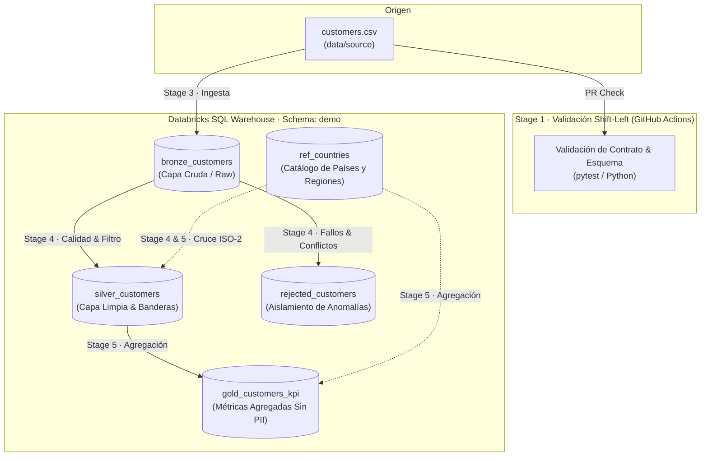

# Constitución · Stack Tecnológico y Arquitectura de Datos

## 1. Principios de Arquitectura

1. **Infraestructura y Modelo como Código**: Ningún objeto (esquema, tabla o vista) se crea manualmente mediante la consola o interfaces web. Todo el DDL y DML está versionado en el repositorio git y se despliega automáticamente.
2. **Calidad Shift-Left**: La validación de contratos de datos y sintaxis se ejecuta en la etapa más temprana posible (en el Pull Request sobre el runner de CI), evitando desperdicio de cómputo en la plataforma de datos.
3. **Idempotencia y Trazabilidad**: Todo proceso del pipeline puede ejecutarse múltiples veces sobre el mismo conjunto de datos sin generar duplicidad de registros ni efectos colaterales. Cada registro procesado cuenta con metadatos de auditoría (`execution_id`, timestamps).
4. **Desacoplamiento de Herramientas**: La arquitectura privilegia las prácticas de ingeniería sobre las herramientas particulares. Cada componente del stack cuenta con alternativas abiertas y comerciales directas.

---

## 2. Tecnologías Seleccionadas y Equivalencias

El stack base está optimizado para simplicidad operativa, gobernanza y ejecución sin servidor (*serverless*).

| Componente / Práctica | Tecnología Seleccionada | Alternativa Comercial | Alternativa Open Source / Local |
| :--- | :--- | :--- | :--- |
| **Plataforma Analítica y Motor SQL** | Databricks SQL Warehouse (schema `demo`) | Snowflake, Google BigQuery, AWS Redshift | DuckDB, Apache Trino / Presto, PostgreSQL |
| **Formato de Almacenamiento** | Delta Lake (formato nativo de Databricks) | Snowflake Micro-partitions, BigQuery Native | Apache Iceberg, Apache Hudi |
| **Orquestación y CI/CD** | GitHub Actions | GitLab CI/CD, Azure DevOps Pipelines | Apache Airflow, Prefect, Dagster |
| **Lenguajes de Ejecución** | Python (3.10+) y SQL (ANSI / Databricks) | PySpark, dbt Cloud | dbt-core, SQLMesh |
| **Validación y Pruebas Shift-Left** | Python con `pytest` y validadores de esquema | Great Expectations Cloud, Monte Carlo | Great Expectations, Soda Core, Cerberus |
| **Gestión de Secretos** | GitHub Encrypted Secrets | AWS Secrets Manager, Azure Key Vault | HashiCorp Vault, Variables de entorno locales |

---

## 3. Arquitectura Medallion y Modelo de Datos

El producto adopta el patrón Medallion (Bronze, Silver, Gold), extendido con una tabla de aislamiento de anomalías (`rejected_customers`) y una dimensión de referencia geográfica (`ref_countries`).

---

### 3.1 Modelo Lógico (Entidades y Relaciones)

- **Cliente Crudo (`BronzeCustomer`)**: Entidad transaccional tal cual proviene del archivo exportado.
- **Cliente Limpio (`SilverCustomer`)**: Cliente individual calificado, normalizado y evaluado para contacto.
- **Cliente Rechazado (`RejectedCustomer`)**: Registro original defectuoso o en conflicto, documentado con causa raíz.
- **País (`CountryReference`)**: Dimensión geográfica maestra con códigos ISO-2, nombre oficial y región.
- **Métricas de Contactabilidad (`GoldCustomersKPI`)**: Resumen periódico agregado a nivel de país y región para consumo de BI.

Relación lógica:
- `SilverCustomer` pertenece a un `CountryReference` (N:1) mediante `country = country_code`.
- `GoldCustomersKPI` consolida métricas de `SilverCustomer` agrupadas por `CountryReference`.

---

### 3.2 Modelo Físico (Tablas y Esquemas en Databricks)

#### 1. `demo.bronze_customers` (Capa Bronze - Ingesta Cruda)
Almacena el contenido íntegro del archivo de origen sin transformaciones destructivas, garantizando fidelidad e inmutabilidad.

| Columna | Tipo de Dato | Nulable | Descripción |
| :--- | :--- | :--- | :--- |
| `customer_id` | `STRING` | Sí | Identificador original del CRM |
| `name` | `STRING` | Sí | Nombre original sin procesar |
| `age` | `STRING` | Sí | Edad en formato texto tal como viene en origen |
| `country` | `STRING` | Sí | Código de país provisto |
| `email` | `STRING` | Sí | Correo electrónico provisto |
| `source_file` | `STRING` | No | Nombre del archivo de procedencia (`customers.csv`) |
| `execution_id` | `STRING` | No | UUID identificador de la ejecución de carga |
| `ingested_at` | `TIMESTAMP` | No | Fecha y hora UTC de la ingesta |

#### 2. `demo.ref_countries` (Tabla Dimensional de Referencia)
Catálogo maestro de países y regiones para normalización y reportería.

| Columna | Tipo de Dato | Clave | Nulable | Descripción |
| :--- | :--- | :--- | :--- | :--- |
| `country_code` | `STRING` (CHAR 2) | PK | No | Código ISO de 2 letras (PE, CL, CO, MX, AR) |
| `country_name` | `STRING` | | No | Nombre oficial (Perú, Chile, Colombia, México, Argentina) |
| `region` | `STRING` | | No | Región geográfica (Sudamérica, Norteamérica) |

#### 3. `demo.silver_customers` (Capa Silver - Datos Limpios y Banderas de Negocio)
Clientes individuales que aprobaron todas las reglas de calidad y deduplicación.

| Columna | Tipo de Dato | Clave | Nulable | Descripción / Regla |
| :--- | :--- | :--- | :--- | :--- |
| `customer_id` | `STRING` | PK | No | Identificador único del cliente |
| `name` | `STRING` | | No | Nombre limpio y normalizado (sin espacios sobrantes) |
| `age` | `INT` | | No | Edad validada como entero numérico ($\ge 0$) |
| `country` | `STRING` | FK | No | Código ISO validado contra `ref_countries` |
| `email` | `STRING` | | No | Correo con sintaxis válida RFC 5322 |
| `es_mayor_edad` | `BOOLEAN` | | No | `TRUE` si `age >= 18`, caso contrario `FALSE` |
| `es_contactable` | `BOOLEAN` | | No | `TRUE` si `email IS NOT NULL AND es_mayor_edad = TRUE` |
| `execution_id` | `STRING` | | No | UUID de la ejecución que procesó el registro |
| `processed_at` | `TIMESTAMP` | | No | Fecha y hora UTC del procesamiento en Silver |

> **Nota de Gobierno sobre Menores de Edad**: Los clientes menores de 18 años **NO** se consideran registros defectuosos de calidad; forman parte de `silver_customers` con `es_mayor_edad = FALSE` y `es_contactable = FALSE`, garantizando que el equipo de Marketing los excluya automáticamente de las campañas por correo conforme a la exigencia de Patricia.

#### 4. `demo.rejected_customers` (Aislamiento de Anomalías de Calidad)
Registros que fallaron reglas de integridad, formato o deduplicación.

| Columna | Tipo de Dato | Nulable | Descripción |
| :--- | :--- | :--- | :--- |
| `rejection_id` | `STRING` | No | UUID único del evento de rechazo |
| `customer_id` | `STRING` | Sí | Identificador original reportado |
| `raw_record` | `STRING` | No | Representación serializada (JSON/CSV) de la fila original |
| `motivo_rechazo` | `STRING` | No | Causa técnica/negocio del rechazo (ej. email inválido, edad no numérica) |
| `execution_id` | `STRING` | No | UUID de la ejecución |
| `rejected_at` | `TIMESTAMP` | No | Fecha y hora UTC del descarte |

#### 5. `demo.gold_customers_kpi` (Capa Gold - Métricas Agregadas de Negocio)
Tabla analítica para el equipo de BI (Andrés). **Completamente desprovista de datos personales (PII)**.

| Columna | Tipo de Dato | Nulable | Descripción |
| :--- | :--- | :--- | :--- |
| `country_code` | `STRING` | No | Código de país (PE, CL, CO, etc.) |
| `country_name` | `STRING` | No | Nombre completo del país (ej. Perú, Chile) |
| `region` | `STRING` | No | Región geográfica (ej. Sudamérica, Norteamérica) |
| `total_clientes` | `BIGINT` | No | Total de clientes en padrón limpio Silver |
| `total_contactables` | `BIGINT` | No | Total con `es_contactable = TRUE` |
| `total_no_contactables`| `BIGINT` | No | Total con `es_contactable = FALSE` |
| `total_mayores_edad` | `BIGINT` | No | Total con `es_mayor_edad = TRUE` |
| `total_menores_edad` | `BIGINT` | No | Total con `es_mayor_edad = FALSE` |
| `pct_contactabilidad`| `DOUBLE` | No | Porcentaje `(total_contactables / total_clientes) * 100` |
| `execution_id` | `STRING` | No | UUID de la ejecución analítica |
| `calculated_at` | `TIMESTAMP` | No | Fecha y hora UTC del cálculo de métricas |

---

## 4. Reglas de Calidad y Deduplicación

### 4.1 Criterio de Rechazo por Atributo
Un registro de Bronze es enviado a `rejected_customers` si presenta cualquiera de los siguientes fallos:
1. **`customer_id` inválido**: Nulo, vacío o con caracteres de control.
2. **`name` inválido**: Nulo, cadena vacía o formado exclusivamente por espacios en blanco (`TRIM(name) = ''`).
3. **`age` inválida**: Nulo, cadena vacía o valor no convertible a entero positivo (ej. `"abc"`, negativos o $> 120$).
4. **`country` inválido**: Nulo, vacío o código que no exista en la tabla dimensional `ref_countries`.
5. **`email` inválido**: Nulo, vacío, carente de `@`, sin dominio o con formato que no cumpla la expresión regular estándar (`^[A-Za-z0-9._%+-]+@[A-Za-z0-9.-]+\.[A-Za-z]{2,}$`).

### 4.2 Política de Desempate y Deduplicación
Ante colisiones de `customer_id` en el archivo origen:
- **Duplicados Exactos**: Si dos o más registros tienen exactamente los mismos valores en todos los campos (`customer_id`, `name`, `age`, `country`, `email`), se conserva una única instancia en `silver_customers` y las instancias duplicadas se registran en `rejected_customers` con el motivo `"Duplicado exacto"`.
- **Conflictos de Identidad (Divergencia de datos)**: Si dos o más registros comparten el mismo `customer_id` pero difieren en al menos un campo (por ejemplo, distinto nombre, edad, país o correo), **todos los registros en conflicto son rechazados** y dirigidos a `rejected_customers` con el motivo `"Conflicto de identidad: customer_id duplicado con datos divergentes"`. Ninguno ingresa a Silver hasta que el CRM de origen resuelva la discrepancia.

### 4.3 Política de Umbral de Fallo del Pipeline
- En el **Stage 4 (Calidad de datos)**, tras clasificar registros limpios y rechazados, se calcula:
  $$\text{Tasa de Rechazo} = \frac{\text{Conteo en } \texttt{rejected\_customers}}{\text{Total de filas en } \texttt{bronze\_customers}} \times 100$$
- **Umbral de Calidad**: **$20\%$**.
  - Si $\text{Tasa de Rechazo} \le 20\%$: El stage concluye exitosamente con advertencia (*warning*) documentada en los logs, permitiendo que los registros limpios continúen a Silver y Gold.
  - Si $\text{Tasa de Rechazo} > 20\%$: El stage **falla con error bloqueante**, aborta la ejecución del pipeline, omite la actualización de la capa Gold y emite una alerta para que Ingeniería y Analítica actúen antes del horario de consumo de Carmen.

---

## 5. Gobierno, Privacidad y Seguridad

1. **Gestión Estricta de Credenciales**:
   - Prohibido incluir tokens, contraseñas, URLs privadas o identificadores de almacén dentro del código fuente.
   - La ejecución en CI/CD depende exclusivamente de **3 secrets en GitHub**:
     - `DATABRICKS_HOST`: URL del workspace de Databricks (ej. `https://dbc-xxxx.cloud.databricks.com`).
     - `DATABRICKS_TOKEN`: Personal Access Token (PAT) o token de Service Principal.
     - `DATABRICKS_HTTP_PATH`: Ruta HTTP del SQL Warehouse (ej. `/sql/1.0/warehouses/xxxx`).
2. **Protección de Datos Personales (PII)**:
   - Los correos electrónicos y nombres de clientes residen únicamente en `silver_customers` con acceso restringido por roles mediante permisos de Databricks SQL (acceso exclusivo para automatización de campañas de CRM).
   - La capa Gold (`gold_customers_kpi`) es 100% agregada y de acceso general para Analítica/BI, garantizando cero exposición de PII.
3. **Pistas de Auditoría**:
   - Cada stage genera y propaga un identificador de corrida (`execution_id`) y una bitácora con hora de inicio, término, cantidad de filas leídas, procesadas, rechazadas y estatus final.

---

## 6. Estrategia de Ramas y Pipeline por Stages

### 6.1 Política de Ramas
- La rama `main` está protegida contra commits directos.
- Todo desarrollo se realiza en ramas de feature / fase (ej. `fase-1-diseno-shift-left`, `fase-2-pipeline-e2e`).
- Solo se permite el merge hacia `main` mediante **Pull Request** y con todos los checks del workflow de GitHub Actions en verde.

### 6.2 Secuencia de Stages del Pipeline

El pipeline se ejecuta de forma lineal y determinística a través de 6 stages numerados:

1. **Stage 1 · Calidad Shift-Left**:
   - *Entorno*: Runner de GitHub Actions (Python).
   - *Momento*: En cada Pull Request antes de realizar merge o interactuar con Databricks.
   - *Acción*: Ejecuta tests de contrato sobre [customers.csv](file:///Users/rosa/Proyectos/utec/sdd/data/source/customers.csv) verificando existencia de columnas requeridas, cabeceras exactas y validación de tipos sintácticos.
2. **Stage 2 · Despliegue del Modelo**:
   - *Entorno*: Databricks SQL Warehouse.
   - *Acción*: Ejecuta scripts DDL idempotentes (`CREATE TABLE IF NOT EXISTS`) para inicializar `ref_countries`, `bronze_customers`, `silver_customers`, `rejected_customers` y `gold_customers_kpi` en el schema `demo`.
3. **Stage 3 · Ingesta a Bronze**:
   - *Entorno*: Databricks SQL Warehouse.
   - *Acción*: Inserta el lote crudo de [customers.csv](file:///Users/rosa/Proyectos/utec/sdd/data/source/customers.csv) en `demo.bronze_customers`, asignando `execution_id` y timestamp de carga.
4. **Stage 4 · Calidad de Datos (Silver + Rechazados)**:
   - *Entorno*: Databricks SQL Warehouse.
   - *Acción*: Aplica validación de reglas, filtra duplicados totales y conflictos de identidad, deriva banderas (`es_mayor_edad`, `es_contactable`), inserta en `silver_customers` y `rejected_customers`, y calcula la tasa de rechazo frente al umbral del 20%. Si supera el 20%, el pipeline se detiene inmediatamente.
5. **Stage 5 · Agregación Gold**:
   - *Entorno*: Databricks SQL Warehouse.
   - *Acción*: Realiza el cruce entre `silver_customers` y `ref_countries` para poblar `gold_customers_kpi` con métricas por país y región, actualizadas para el consumo de las 8:00 a. m.
6. **Stage 6 · Monitoreo y Auditoría**:
   - *Entorno*: GitHub Actions / Databricks.
   - *Acción*: Registra en logs consolidados el resumen de la ejecución (filas leídas, porcentaje de rechazo, KPI de contactabilidad alcanzado) y reporta el estado final a los canales correspondientes.
